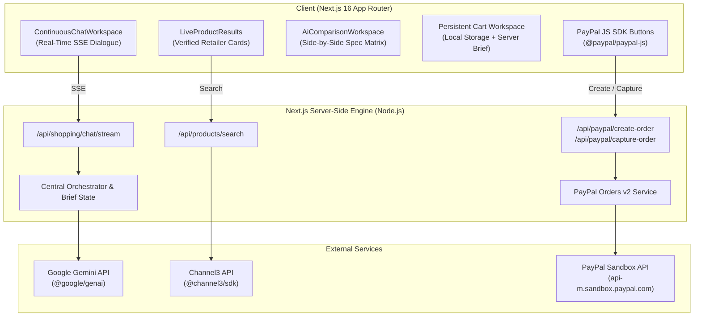

# SpendPilot AI

> **Conversational product discovery, grounded specification comparisons, and multi-seller checkout powered by Google Gemini, Channel3, and PayPal Sandbox.**

---

## 1. Product Overview

SpendPilot AI is an autonomous, open-category shopping companion designed for the **PayPal AI Hackathon 2026**. Instead of forcing shoppers through rigid filter menus or generating hallucinated product recommendations, SpendPilot combines natural-language conversational reasoning via Google Gemini, live multi-merchant product and pricing data via Channel3, and server-authoritative multi-seller split checkout via the PayPal Orders v2 REST API.

---

## 2. The Real Shopping Problem

Online shopping today suffers from three fundamental bottlenecks:

1. **Rigid Filter Tax**: Finding the right product requires clicking through dozens of dropdowns, checkboxes, and technical specs that shoppers often do not fully understand.
2. **AI Hallucinations in Commerce**: Generic AI shopping chatbots frequently invent non-existent models, state outdated prices, or recommend products without verified retailer stock.
3. **Fragmented Multi-Merchant Purchasing**: When purchasing complementary items (e.g. A laptop from one specialist and headphones from another), shoppers must execute separate checkout flows across multiple websites, repeatedly entering payment details.

---

## 3. SpendPilot's Solution

SpendPilot AI delivers an integrated, verified shopping experience:

- **Goal-Oriented Dialogue**: Shoppers express requirements in natural language (e.g., *"I need a laptop for professional web development under $1,200"*). SpendPilot extracts categories, purposes, and budget limits automatically.
- **Grounded Retail Discovery**: Powered by Channel3, SpendPilot queries live merchant catalogs, retrieving actual retailer offers with live pricing, stock availability, and merchant links.
- **Structured Specification Comparison**: Canonicalizes conflicting technical spec sheets across different retailers into clean, objective comparison tables highlighting critical trade-offs.
- **Multi-Task Workspace & Persistent Cart**: Maintains distinct shopping tasks without context leakage, preserving selections across refreshes.
- **PayPal Multi-Seller Split Checkout**: Demonstrates multi-merchant split checkout where a single buyer approval captures payments across multiple independent sellers using PayPal Orders v2.

---

## 4. Application Screenshots

### Conversational Discovery & Shopping Workspace

*SpendPilot's natural-language dialogue workspace with real-time streaming, goal extraction, and contextual quick replies.*

### Persistent Multi-Item Cart & Shopping List

*Persistent shopping cart tracking multi-item budgets, verified retailer prices, and item status.*

### PayPal Multi-Seller Sandbox Checkout

*Server-authoritative multi-seller checkout demonstrating split captures across independent Sandbox merchants.*

---

## 5. Key Implemented Features

- **Open-Category Conversational Engine**: Dynamic slot-filling for any product category (electronics, furniture, laboratory equipment, apparel, tools) without hardcoded question trees.
- **Intelligent Delegation**: Responds naturally when shoppers say *"u suggest"*, *"you choose"*, or *"no preference"*, transitioning to thinking mode (`SpendPilot is thinking...`) and presenting top-rated options within budget.
- **Question-Search Mutual Exclusion**: Strict architectural gate guaranteeing product search never executes while the assistant is asking a clarification question.
- **Channel3 Live Offer Grounding**: Retrieves real-time offers from major retailers (Apple, Best Buy, B&H, etc.) with exact prices, shipping availability, and direct retailer links.
- **Objective Spec Comparisons**: Contrasts up to 4 candidate products across standardized attribute rows (Display, Processor, Memory, Storage, Battery Life, Materials).
- **Product Variant Selection**: Visual configurator for selecting colorways, storage tiers, and sizes with dynamic image switching.
- **Task Isolation**: Strict scoping of shopping briefs so attributes from earlier searches (e.g., leather gaming chairs) never contaminate subsequent searches (e.g., headphones).
- **Server-Authoritative PayPal Orders v2**: Constructs multi-purchase-unit orders with distinct payee merchant accounts and verifies separate capture transactions.

---

## 6. How the Shopping Workflow Works

```
1. Express Need  -->  Shopper types query (e.g. "laptop for web development under $1200")
2. Clarification -->  SpendPilot asks at most 1 essential question with clickable options
3. Delegation    -->  Shopper can pick an option or say "u suggest" to proceed
4. Live Search   -->  Channel3 fetches verified retailer offers within budget
5. Comparison    -->  Side-by-side spec matrix contrasts trade-offs across 2-4 products
6. Selection     -->  Selected product is added to My Shopping List in persistent cart
7. Multi-Task    -->  Shopper can add more items (e.g. "now I need headphones under $200")
8. PayPal Demo   -->  Multi-seller checkout executes independent split captures across registered merchants
```

---

## 7. System Architecture

SpendPilot AI separates client presentation, server-side orchestration, and external service gateways:



For detailed architectural specifications and data flow documentation, see [docs/ARCHITECTURE.md](docs/ARCHITECTURE.md).

---

## 8. How Google Gemini is Used

SpendPilot uses the official `@google/genai` SDK on the server-side with priority routing:
- **Primary Model**: `gemini-3.1-flash-lite` (low latency, high reasoning fidelity).
- **Automatic Failover Chain**: Fails over to `gemini-3.5-flash-lite` and `gemini-3.8-flash` on upstream capacity spikes.
- **Structured Orchestration**: Analyzes user input to construct and update an authoritative `ShoppingBrief` schema containing product category, constraints, and budget limits.
- **Streaming Concierge**: Uses `generateContentStream` to stream natural assistant dialogue in real time via Server-Sent Events.
- **Specification Contrast**: Analyzes technical attribute vectors to generate objective trade-off summaries between competing products.

---

## 9. How Channel3 is Used

Channel3 powers SpendPilot's real-time product discovery via `@channel3/sdk`:
- **Live Catalog Queries**: Executes grounded product retrieval against real e-commerce retailer inventories.
- **Offer Normalization**: Extracts multi-retailer offers, price minor units, currency codes, merchant domains, and in-stock statuses.
- **Specification Normalization**: Standardizes non-uniform retailer product specifications into canonical attributes (e.g. Battery capacity, weight, materials, dimensions).
- **Direct Merchant Links**: Provides direct retailer links so shoppers can purchase directly from external merchants.

---

## 10. How PayPal Sandbox Integration Works

SpendPilot demonstrates multi-seller e-commerce checkout using the official PayPal Orders v2 REST API:
- **Server-Authoritative Intent**: The server builds the order payload with `intent: "CAPTURE"` and multiple `purchase_units`, each assigned a specific demo merchant payee (`SpendPilot Audio Lab`, `SpendPilot Workspace Gear`).
- **One-Click Buyer Approval**: The shopper logs into PayPal Sandbox once through the official PayPal JavaScript SDK popup window.
- **Multi-Seller Split Capture**: On the backend (`/api/paypal/capture-order`), SpendPilot captures the order, generating separate PayPal capture IDs and payment allocations for each merchant.
- **Receipt Transparency**: Renders a verified receipt displaying the breakdown of funds allocated to each independent seller.

> [!NOTE]
> All PayPal transactions run strictly on `https://api-m.sandbox.paypal.com` with virtual sandbox currency. No real payment methods are charged.

---

## 11. Technology Stack

- **Framework**: Next.js 16 (App Router, Turbopack)
- **Frontend**: React 19, TypeScript, Tailwind CSS v4, Lucide React
- **AI & Reasoning**: Google GenAI SDK (`@google/genai`), Google Gemini Flash models
- **Product Retrieval**: Channel3 SDK (`@channel3/sdk`)
- **Payments**: PayPal Orders v2 REST API, `@paypal/paypal-js`
- **Validation & Math**: Zod, custom currency minor-unit arithmetic
- **Testing**: Node.js native test runner (`node:test`, `node:assert`)
- **Deployment**: Vercel (Serverless Node.js runtime)

---

## 12. Prerequisites

- **Node.js**: `26.x` (`>=26.0.0` required, matching `package.json` engines and GitHub Actions CI)
- **Package Manager**: `npm` (v10+)
- **API Keys & Credentials**:
  - Google Gemini API Key ([Google AI Studio](https://aistudio.google.com/))
  - Channel3 API Key ([Channel3 Portal](https://trychannel3.com/))
  - PayPal Developer Sandbox Account ([PayPal Developer](https://developer.paypal.com/))

---

## 13. Installation & Local Setup

1. **Clone the repository**:
   ```bash
   git clone https://github.com/Tmahim-09/spendpilot-ai.git
   cd spendpilot-ai
   ```

2. **Verify Node.js version**:
   ```bash
   node -v  # Must report v26.x
   ```

3. **Install dependencies**:
   ```bash
   npm ci
   ```

4. **Configure environment variables**:
   ```bash
   cp .env.example .env.local
   ```
   Edit `.env.local` with your credentials (see [Environment Variables](#14-environment-variables)). Never commit `.env.local` to Git.

---

## 14. Environment Variables

| Variable | Description | Requirement | Scope | Default / Example |
| :--- | :--- | :--- | :--- | :--- |
| `GEMINI_API_KEY` | Google Gemini API Key | **Required for AI** | Server-Only | — |
| `GEMINI_MODEL` | Primary conversational model | Optional | Server-Only | `gemini-3.1-flash-lite` |
| `GEMINI_FALLBACK_MODELS` | Fallback model chain for capacity spikes | Optional | Server-Only | `gemini-3.5-flash-lite,gemini-3.8-flash` |
| `CHANNEL3_API_KEY` | Channel3 Product Discovery API key | **Required for Search** | Server-Only | — |
| `NEXT_PUBLIC_PAYPAL_CLIENT_ID` | PayPal Sandbox REST Client ID (browser SDK) | **Required for Checkout** | Public / Client | Sandbox Client ID |
| `PAYPAL_CLIENT_ID` | PayPal Sandbox REST Client ID (server verification) | **Required for Checkout** | Server-Only | Must match `NEXT_PUBLIC_PAYPAL_CLIENT_ID` |
| `PAYPAL_CLIENT_SECRET` | PayPal Sandbox REST Client Secret | **Required for Checkout** | Server-Only | — |
| `PAYPAL_CHECKOUT_SIGNING_SECRET` | Cryptographic secret for signing server checkout tokens (min 32 chars) | **Required for Checkout** | Server-Only | Random 32+ hex chars |
| `PAYPAL_ENV` | Target environment (strictly sandbox-only) | **Required** | Server-Only | `sandbox` |
| `PAYPAL_API_BASE` | PayPal REST endpoint | **Required** | Server-Only | `https://api-m.sandbox.paypal.com` |
| `PAYPAL_DEMO_SELLER_A_MERCHANT_ID` | Demo Seller A (SpendPilot Audio Lab) Account ID | **Required for Demo** | Server-Only | Sandbox Merchant Account ID |
| `PAYPAL_DEMO_SELLER_A_EMAIL` | Demo Seller A Sandbox Account Email | Optional | Server-Only | `seller_a@spendpilot.test` |
| `PAYPAL_DEMO_SELLER_B_MERCHANT_ID` | Demo Seller B (SpendPilot Workspace Gear) Account ID | **Required for Demo** | Server-Only | Sandbox Merchant Account ID |
| `PAYPAL_DEMO_SELLER_B_EMAIL` | Demo Seller B Sandbox Account Email | Optional | Server-Only | `seller_b@spendpilot.test` |
| `PAYPAL_PARTNER_ATTRIBUTION_ID` | PayPal Partner Attribution ID (Build Notation code) | Optional | Server-Only | — |

> [!IMPORTANT]
> - `NEXT_PUBLIC_PAYPAL_CLIENT_ID` is intentionally public for the PayPal JS SDK and must strictly reference your Sandbox Client ID.
> - All other variables are **Server-Only** and must never be exposed to the browser or returned in API responses.
> - `PAYPAL_ENV` and `PAYPAL_API_BASE` strictly reject live production endpoints.

---

## 15. Vercel Deployment Guide

SpendPilot AI is configured to run as a serverless Next.js App Router application on Vercel Node.js Functions (`nodejs` runtime).

### A. Deploying a Preview Deployment from `release/hardening`

1. **Connect Repository to Vercel**:
   - In the [Vercel Dashboard](https://vercel.com/), select **Add New Project** and import `Tmahim-09/spendpilot-ai`.
   - Ensure the framework preset is detected as **Next.js**.

2. **Configure Node.js Version**:
   - SpendPilot requires **Node.js 26.x**.
   - In **Project Settings -> General -> Node.js Version**, select `26.x`.

3. **Configure Environment Variables**:
   - In **Project Settings -> Environment Variables**, add the required variables listed in the [Environment Variables](#14-environment-variables) table.
   - For a Preview Deployment, ensure you enable the **Preview** environment checkbox for each variable.
   - For `NEXT_PUBLIC_PAYPAL_CLIENT_ID`, add the public Sandbox Client ID.

4. **Trigger Preview Build**:
   - Push commits to `release/hardening` (or create a pull request into `main`).
   - Vercel automatically creates an isolated Preview Deployment with a unique URL (`https://spendpilot-ai-git-release-hardening-...vercel.app`).
   - **Do not publish or promote this deployment to Production.**

### B. Configuring the PayPal Sandbox Demonstration

1. In the [PayPal Developer Dashboard](https://developer.paypal.com/), navigate to **Testing Tools -> Sandbox Accounts**.
2. Note your primary Sandbox REST App Client ID and Secret (`PAYPAL_CLIENT_ID`, `PAYPAL_CLIENT_SECRET`).
3. Create or select two Sandbox Business accounts for the demonstration:
   - Copy Account ID for Seller A -> set `PAYPAL_DEMO_SELLER_A_MERCHANT_ID`.
   - Copy Account ID for Seller B -> set `PAYPAL_DEMO_SELLER_B_MERCHANT_ID`.
4. Generate a random 32-character secret for `PAYPAL_CHECKOUT_SIGNING_SECRET`:
   ```bash
   openssl rand -hex 32
   ```
5. Add these variables to your Vercel Project Settings under the **Preview** scope.

### C. Redeploying After Updating Environment Variables

Vercel environment variables are injected at deployment time. If you update or add environment variables:
1. Navigate to **Deployments** in your Vercel Dashboard.
2. Select your latest Preview deployment.
3. Click the three dots (`...`) and select **Redeploy**.
4. Leave *Use existing Build Cache* unchecked if you updated public (`NEXT_PUBLIC_`) variables.

### D. Deployment Health Check Endpoint

SpendPilot provides a lightweight, non-leaking diagnostic health endpoint at `GET /api/health`.

Example response:
```json
{
  "status": "ok",
  "application": "SpendPilot AI",
  "runtime": "v26.4.0",
  "environment": "preview",
  "commit": "e125551",
  "timestamp": "2026-11-11T20:00:00.000Z"
}
```
*Note: This endpoint strictly returns safe diagnostic metadata and never exposes credentials, keys, or seller information.*

---

## 16. Local Development Commands

- **Start dev server**:
  ```bash
  npm run dev
  ```
  Open [http://localhost:3000](http://localhost:3000) to use the shopping interface, or [http://localhost:3000/paypal-demo](http://localhost:3000/paypal-demo) to test multi-seller checkout directly.

---

## 17. Testing and Verification Commands

- **Typecheck**:
  ```bash
  npm run typecheck
  ```
- **Lint**:
  ```bash
  npm run lint
  ```
- **Run automated test suite**:
  ```bash
  npm test
  ```
- **Build production bundle**:
  ```bash
  npm run build
  ```

---

## 18. Security & Sandbox Safety

- **No Secrets in Browser Bundles**: All Gemini, Channel3, and PayPal Client Secrets are restricted strictly to server-side Node.js routes.
- **Authoritative Server Pricing**: The client never passes order prices to the server. Pricing is validated and calculated on the server before dispatching to PayPal.
- **Sandbox Enforcement**: Hardcoded to PayPal Sandbox endpoints. Production live credentials cannot be used.
- **Security Headers**: Configured with `X-Content-Type-Options: nosniff`, `Referrer-Policy: strict-origin-when-cross-origin`, and `X-Frame-Options: SAMEORIGIN`.
- See [SECURITY.md](SECURITY.md) for vulnerability disclosure procedures.

---

## 19. Current Limitations

- **Channel3 Retailer Purchases**: External retailer cards link directly to merchant sites; SpendPilot does not process credit cards for external retailers.
- **Sandbox Demo Merchants**: The PayPal multi-seller checkout demonstration executes across mock demo merchants (`SpendPilot Audio Lab`, `SpendPilot Workspace Gear`).

---

## 20. Hackathon Documentation Links

- **[Judge Evaluation Guide (5-Minute Walkthrough)](docs/JUDGE_GUIDE.md)**
- **[System Architecture & Data Flows](docs/ARCHITECTURE.md)**
- **[Devpost Submission Draft](docs/DEVPOST_DRAFT.md)**
- **[Video Demonstration Script](docs/DEMO_SCRIPT.md)**
- **[Third-Party Notices & Licenses](THIRD_PARTY_NOTICES.md)**

---

## 21. Team & Acknowledgements

Created for the **PayPal AI Hackathon 2026**. Special thanks to Google Cloud & Gemini for conversational AI models, Channel3 for real-time commerce data indexing, and PayPal for Orders v2 multi-seller developer APIs.

---

## 22. License

This project is licensed under the **MIT License** — see the [LICENSE](LICENSE) file for details.

