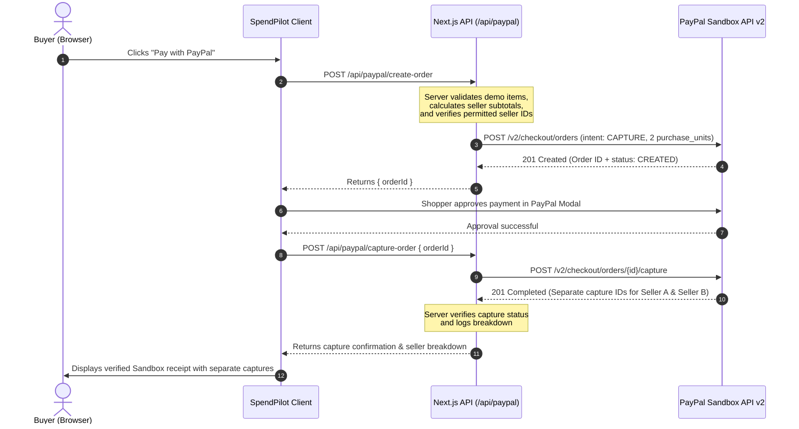

# SpendPilot AI: System Architecture

SpendPilot AI is a conversational commerce engine that unites natural-language conversational reasoning (Google Gemini), live multi-merchant product discovery (Channel3), and server-authoritative multi-seller checkout (PayPal Sandbox).

---

## 1. High-Level System Architecture

```mermaid
flowchart TD
    subgraph Client ["Client Layer (Next.js 16 App Router)"]
        ChatUI["ContinuousChatWorkspace\n(Natural Dialogue & Stream Listener)"]
        ResultsUI["LiveProductResults\n(Product Cards & Filters)"]
        ComparisonUI["AiComparisonWorkspace\n(Side-by-Side Spec Comparison)"]
        ConfiguratorUI["ProductVariantConfigurator\n(Color / Size / Storage Selection)"]
        CartUI["Cart & Shopping List\n(Persistent Multi-Item Workspace)"]
        PayPalUI["PayPal Multi-Seller Buttons\n(@paypal/paypal-js SDK)"]
    end

    subgraph Edge ["Next.js Server-Side API Layer (Node.js)"]
        ChatStreamAPI["/api/shopping/chat/stream\n(SSE Chunk Streamer)"]
        ChatJSONAPI["/api/shopping/chat\n(Standard Fallback Route)"]
        SearchAPI["/api/products/search\n(Price Policy & Grounded Search)"]
        VariantAPI["/api/products/variants\n(Variant Matrix Resolver)"]
        PayPalCreateAPI["/api/paypal/create-order\n(Multi-Capture Intent Builder)"]
        PayPalCaptureAPI["/api/paypal/capture-order\n(Atomic Split Capture Verifier)"]
    end

    subgraph Services ["Core Server Services & State Controllers"]
        Orchestrator["Central Orchestrator\n(Intent, Shopping Brief & Task Slots)"]
        StreamingEngine["Streaming Concierge Engine\n(Real-Time Dialogue Streamer)"]
        Channel3Client["Channel3 Client\n(SDK Wrapper & Spec Normalizer)"]
        ComparisonService["AI Comparison Service\n(Gemini Spec Contrast & Tradeoffs)"]
        WorkspaceManager["Workspace Manager\n(Budget Tracking & Multi-Task State)"]
        PayPalOrdersService["PayPal Orders Service\n(OAuth2 Token & REST API v2)"]
    end

    subgraph External ["External Providers & Sandboxes"]
        GeminiAPI["Google Gemini API\n(gemini-3.1-flash-lite / 3.5 / 2.5)"]
        Channel3API["Channel3 API\n(Live Retailer Catalog & Multi-Store Crawl)"]
        PayPalSandbox["PayPal REST API v2\n(api-m.sandbox.paypal.com)"]
    end

    %% Client to Server Connections
    ChatUI -->|SSE Request| ChatStreamAPI
    ChatUI -->|POST JSON Fallback| ChatJSONAPI
    ResultsUI -->|POST /api/products/search| SearchAPI
    ConfiguratorUI -->|POST /api/products/variants| VariantAPI
    PayPalUI -->|POST /api/paypal/create-order| PayPalCreateAPI
    PayPalUI -->|POST /api/paypal/capture-order| PayPalCaptureAPI

    %% Server to Services Connections
    ChatStreamAPI --> StreamingEngine
    ChatJSONAPI --> Orchestrator
    StreamingEngine --> Orchestrator
    StreamingEngine --> WorkspaceManager
    SearchAPI --> Channel3Client
    VariantAPI --> Channel3Client
    SearchAPI --> ComparisonService
    PayPalCreateAPI --> PayPalOrdersService
    PayPalCaptureAPI --> PayPalOrdersService

    %% Services to External APIs
    Orchestrator -->|@google/genai SDK (Server-Only)| GeminiAPI
    StreamingEngine -->|generateContentStream (Server-Only)| GeminiAPI
    ComparisonService -->|generateContent (Server-Only)| GeminiAPI
    Channel3Client -->|@channel3/sdk (Server-Only)| Channel3API
    PayPalOrdersService -->|Server-to-Server HTTPS| PayPalSandbox
```

---

## 2. Component Roles and Execution Boundaries

### A. Client Layer (Browser)
- **Zero Secrets**: Neither `GEMINI_API_KEY`, `CHANNEL3_API_KEY`, nor `PAYPAL_CLIENT_SECRET` are ever delivered to or accessible by the browser. Only public application IDs (`NEXT_PUBLIC_PAYPAL_CLIENT_ID`) are loaded by the PayPal JavaScript SDK.
- **Continuous Workspace**: Renders the natural chat stream, product cards, side-by-side spec comparisons, and the shopping list with verified merchant prices.
- **Client-Side State**: Synchronizes with server-authoritative session revisions. Cart persistence is backed by local storage and synced with server-issued shopping brief structures.

### B. Server Layer (Next.js App Router on Node.js)
- **Central Orchestration (`src/lib/orchestrator/`)**:
  - Extracts user goals, budget constraints, and product categories into structured `ShoppingBrief` objects.
  - Detects user intent (new tasks vs. refinements vs. delegation like "u suggest").
  - Enforces mutual exclusion: a question turn **never** initiates product retrieval.
- **Streaming Concierge (`src/lib/concierge/`)**:
  - Leverages `@google/genai` to stream natural assistant dialogue in real-time server-sent events (`data: {...}`).
  - Employs automatic model failover (`gemini-3.1-flash-lite` -> `gemini-3.5-flash-lite` -> `gemini-2.5-flash-lite`).
- **Product Discovery & Comparison (`src/lib/channel3/`, `src/lib/ai/`)**:
  - Queries Channel3 for real-time retailer pricing, stock availability, and multi-merchant offers.
  - Canonicalizes specs (e.g. Battery Life, RAM, Material, Weight) across differing retailer schemas.
  - Generates objective, evidence-based comparative summaries with zero fabricated claims.

---

## 3. PayPal Sandbox vs. Channel3 Demarcation

An essential design principle of SpendPilot AI is the clear separation between live retailer search and the PayPal payment demonstration:

```
+-------------------------------------------------------------+
|                     SPENDPILOT AI                           |
+-------------------------------------------------------------+
         |                                           |
         v                                           v
[ Channel3 Search Engine ]              [ PayPal Sandbox Multi-Seller ]
 - Real retailer offers                  - Controlled demo sellers
   (Best Buy, Apple, B&H, etc.)           (Seller A: Audio Lab,
 - Merchant prices & live links            Seller B: Workspace Gear)
 - Direct purchase on retailer site      - Demonstrates split capture
 - NO simulated bank transactions          and multi-purchase checkout
```

> [!IMPORTANT]
> **Channel3 offers represent genuine external retailers** (such as Apple, Best Buy, or Amazon) where users purchase directly on the merchant's site via external links.
> **The PayPal Sandbox demo executes on controlled demo merchants** (`SpendPilot Audio Lab`, `SpendPilot Workspace Gear`) to demonstrate server-authoritative multi-seller order creation, separate captures, and split payment allocation using official PayPal REST v2 APIs without processing real bank funds.

---

## 4. Multi-Seller PayPal Sandbox Flow



---

## 5. Security Architecture

1. **Server-Only Credentials**:
   - `GEMINI_API_KEY`: Kept on server; accesses Google GenAI SDK.
   - `CHANNEL3_API_KEY`: Kept on server; signs queries to Channel3.
   - `PAYPAL_CLIENT_SECRET`: Kept on server; authenticates OAuth2 Bearer token generation.
2. **Server-Authoritative Pricing**:
   - The client never passes order totals or payment recipient IDs to the server. All pricing and seller assignments are derived server-side.
3. **Sandbox Isolation**:
   - Hardcoded sandbox base URL (`https://api-m.sandbox.paypal.com`).
   - Rejects live credentials and never touches production payment rails.
4. **Defense in Depth**:
   - HTTP Security Headers (`X-Content-Type-Options: nosniff`, `Referrer-Policy: strict-origin-when-cross-origin`, `X-Frame-Options: SAMEORIGIN`).
   - Rate limiting and input validation on all mutation endpoints.
